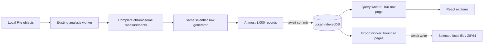

# GEL Web v0.6 — persistent local results and streaming exports

## Scientific contract

This milestone changes storage, transport, exploration and export. It adds no statistical model or candidate score. Frozen fixtures, interval conventions, negative-minus integration, peak stitching, morphology, thresholds, feature-specific statistics and BEDPE anchors remain the references. BigWig changes are descriptive. Shared controls are not independent observations. The negative historical K562 benchmark remains applicable.

Choose **Organize as experiment** for persistent results. The legacy simple view remains bounded and in memory, with its previous guards. Its Blob downloads are not streaming exports.

## Retention audit

| Baseline location | Retained or copied data | Persistent experiment replacement |
|---|---|---|
| `analysis.ts buildLinks` | Complete pair array and sort | Identical `iterateLinks` generator; collecting reference wrapper preserved |
| `chunked-bigwig.ts` | Chromosome arrays accumulated across genome | One chromosome's bounded measurements, then awaited write batches |
| Chromosome result guard | Full JSON copy for 96 MiB estimate | Per-batch and disk limits; no accumulated result serialization |
| Processed importers | Text/features plus all pairs | Existing bounded imports; generator streams pairs |
| Experiment orchestration | All layers/contrasts and duplicate-ID sets | Metadata/counters only; database uniqueness |
| Worker messages / React | Structured-cloned full results | Small status reports; at most 100 queried rows |
| Explorer | Full filter/sort and gene-to-link arrays | Index queries, keyset pages, materialized gene counts |
| Export workers | Cloned outcomes and all formatted files | bounded batch reads and bounded UTF-8 encoding |
| JSZip / download Blob | Full archive buffered | ZIP64 writer to selected file; explicit 64 MiB Blob fallback |

A core cannot finalize a long peak before subsequent cores are examined. Two chromosome passes still precede pairing. Writes begin after complete chromosome measurements, then commit bounded batches before the next chromosome. This is not per-core resume.

The 200,000 peak-summary guard now applies per chromosome in the persistent path. Annotation feature, indexed-query bytes, input file, chunk/concurrency, 100,000-pass and 24-contrast guards remain. Legacy interval manifests still run the bounded regional engine before persistence. No guard was removed from the collecting/reference paths.

## Architecture choice

IndexedDB supplies transactions, uniqueness and ordered indexes without new dependencies. OPFS sequential append was benchmarked and was faster, but does not itself supply genomic indexes or atomic index/payload coordination. File System Access is an export destination rather than a portable query backend.

[SQLite WASM persistence options](https://www.sqlite.org/wasm/doc/trunk/persistence.md) were investigated. SQLite was not installed or benchmarked: VFS, locking and deployment integration add substantial complexity without demonstrated need for SQL in the tested workload. This is not a performance comparison against SQLite. No Vercel project settings or isolation headers were changed.

Database `gel-results-v1`, schema 1:

- `runs`: frozen manifest, thresholds, timestamps, states, outcomes and counters; no uploaded File objects.
- `features`: exact gene/enhancer/promoter features, gene responses and tier counters; includes zero-candidate genes.
- `rows`: compact candidate projections and genomic, distance, magnitude, gene ID, symbol, enhancer, chromosome, contrast and tier indexes.
- `batches`: checkpoint `(run, layer, contrast, partition, sequence)`, SHA-256 identity and compressed scientific rows. Native gzip streams are used where present; JSON is the fallback.

One strict-durability transaction commits checkpoint, rows, feature counters and run counters. Identical retries are no-ops; changed content at an existing checkpoint is rejected. A duplicate candidate in another batch aborts the transaction. Features precede their rows; an interruption can leave explicit partial features. A separate terminal partition marker is written only after every feature/row batch commits; its absence denotes an incomplete partition. These markers do not enable resume.

Write batches: configurable 100–1,000 records (default 500) and a 4 MiB decoded-text estimate. At most eight decoded batches / 8 MiB estimated UTF-16 are cached per connection, plus the current batch of up to 1,000 rows or 100-row view. These estimates exclude object/native overhead. Awaited commits provide backpressure.

## Capacity and failure

The configurable budget limits estimated uncompressed payload, not physical disk use. Indexes, journals and browser bookkeeping can be substantially larger. Origin usage from `navigator.storage.estimate()` is shown separately. Every sixteenth batch reserves 20% of estimated quota or at least 256 MiB. Estimates may lag real disk use; a web page cannot guarantee operating-system free space.

Run states: `running`, `complete`, `cancelled`, `failed`, `partial`. Completion requires finished scanning, all awaited commits and contrast validation. Failed/cancelled comparisons retain committed records with explicit status. Mixed numerical success/failure is partial. Incomplete/excluded comparisons remain in reports. Browser/worker termination can leave `running`; researchers can explicitly mark an interrupted run partial after checking that no other tab is executing it. A small metadata reserve is released at termination to help record failure, without promising a write can succeed on a full device.

Quota failures, conflicting checkpoints, corrupt/missing payloads and worker failures are visible. No silent truncation occurs. Deleting a run makes subsequent writes fail. Cross-tab job coordination is not implemented.

## Indexed exploration

Gene search uses exact case-insensitive identifiers/symbols and deduplicates their union without a full candidate-ID set. Enhancer drilldown, chromosome, contrast and tier use indexes. Unfiltered pages use indexed counts and keyset reads. Residual combinations, including morphology, coordinate overlap and statistical availability, inspect the selected index population in a worker, count exactly, and retain only the next 100 sorted matches. These filters are bounded in memory but may be slow on very large populations.

Stable sorting uses genomic position, contrast and source link ID, with distance/magnitude prefixes when selected. Candidate IDs remain `encodeURIComponent(contrast_id) + "::" + encodeURIComponent(link_id)`. Layers remain separate. Summary panels show the first 100 matching gene summaries; exports include all summaries. Filters never modify saved records.

## Streaming export contract

**Save ZIP directly to disk / Save to disk:** capability-detected save picker, browser file handle transferred to worker, `createWritable`, awaited writes, close after success and abort on error/cancellation. [Browsers generally stage changes until close](https://developer.mozilla.org/en-US/docs/Web/API/FileSystemFileHandle/createWritable); durability still depends on browser and OS.

ZIP64 STORE uses incremental CRC32/data descriptors and a bounded central directory (4,096 entries); explicit archive ceiling 16 GiB. Individual files can be streamed separately. The full archive is never buffered on this path.

Ordinary **Download** buttons buffer the whole file/ZIP as a Blob, capped at 64 MiB. They are not streaming to disk. Oversized downloads fail rather than truncate. Browser crashes can leave temporary files; successful finalization is never inferred from starting a write.

Exports include TSV/CSV, all gene summaries, BED/BEDPE, UCSC interact/tier files, per-contrast/layer tables, manifest, parameters, provenance, execution state and validation. Weak, discordant, insufficient and committed partial rows are retained. Master tables append `execution_status` and `run_state`. Coordinate/strand/anchor semantics are unchanged; table order is deterministic chromosome/contrast and gene-coordinate batch order instead of the old retained symbol sort.

## Privacy, lifecycle and recovery

No analysis backend, upload relay, analytics or external error reporting was added. Source File objects are active-execution references only. Results are local to browser profile/origin; localhost, previews and production have separate stores.

Reopen after reload, delete one run, clear results, and request storage retention through the workspace. Retention is not permanence: [quotas and eviction vary by browser](https://developer.mozilla.org/en-US/docs/Web/API/Storage_API/Storage_quotas_and_eviction_criteria). Export important work.

Safe source-validated resume is **not implemented**. Atomic checkpoints support integrity and interruption inspection, not reuse with replaced files. Restart with source files as a new run. Future resume must validate strong file identity, settings, annotation, contrasts and schema.

## Validation entry points

`storage.spec.ts`: native IndexedDB/OPFS benchmarks, rollback, retries, quota/headroom and paging. `persistent.spec.ts`: reload, filtering, direct-write API path and ZIP CRCs; optional private HEL trials are excluded from ordinary CI. Native picker UI is not automated: tests supply an actual OPFS handle through the same worker/writable-stream interface. Safari/Firefox and native-picker interaction require separate validation. Capability detection is not proof of browser support.
