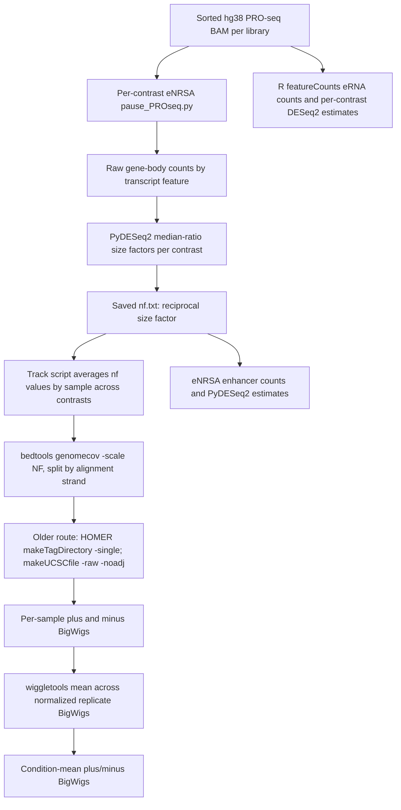

# HEL PRO-seq BigWig provenance and normalization audit

**Audit date:** 2026-10-27
**Primary source:** `/gs/gsfs0/users/araskin/PRO-seq/1_HRB_dAB_1-2-4hr_JCb`
**Scope:** Read-only inspection of source scripts and processed files. No source data or analysis outputs were changed.

## Findings at a glance

The inspected averaged visualization tracks are replicate means of per-sample coverage tracks. For the eNRSA route, each replicate track is first scaled by an eNRSA normalization factor. That factor is the reciprocal of a DESeq2 median-of-ratios size factor estimated for the gene-body count matrix in each case-versus-control contrast. The track-generation scripts average the factor values available for a sample across its eNRSA comparison appearances, then average the resulting per-sample signal tracks within a condition.

This is not BAM pooling. It is not a Drosophila spike-in normalized track set. The DESeq2 feature-level fold changes and BigWig-integrated fold changes are related but are not estimates of exactly the same quantity: the feature statistics use count matrices, contrast-specific offsets, a fitted negative-binomial model, and defined feature intervals; BigWig ratios use integrated coverage from displayed tracks scaled with a sample-level factor averaged across contrasts.

There are two track-generation routes in the dataset. The November 2025 route writes to `normalized_tracks/bigwig_averaged` in the script but the extant directory is named `normalized_tracks_v1/bigwig_averaged`. The May 2026 `multiNF` route writes a separate set to `tracks_out/eNRSA/bigwig/avg`. The inspected scripts and logs verify both routes; no IGV session file or recorded track manifest was found to prove which set was loaded in a particular IGV session. GEL must therefore store the exact track path and source manifest rather than infer the route from a basename.

## Provenance diagram



The newer `multiNF` route uses the same per-sample averaged eNRSA factor but writes strand coverage directly from `bedtools genomecov` bedGraphs to BigWig (minus signal is negated with `awk`); it does not pass through the older HOMER track conversion.

## Exact normalization and averaging

For sample `i` in contrast `c`, eNRSA computes a DESeq2 size factor `s[i,c]` from the gene-body count matrix and writes:

```text
nf[i,c] = 1 / s[i,c]
```

This is explicit in `/gs/gsfs0/users/araskin/eNRSA/utils.py` (`norm_factors = 1 / size_factors`; `nf.txt`). eNRSA's `run_deseq2` calls PyDESeq2 `fit_size_factors()` for the gene-body data. The same size factors are reused for promoter-proximal counts; eRNA enhancer counts use `size_factors_in = 1 / nf` from that contrast. No spike-in factor is used in this branch.

For BigWig generation, the scripts aggregate available contrast-specific factors for each sample by arithmetic mean:

```text
NF[i] = mean_c(nf[i,c])
```

Then for strand `q` and genomic position `x`:

```text
replicate_signal[i,q,x] = NF[i] * aligned_read_coverage[i,q,x]
condition_track[g,q,x] = mean_i_in_group_g(replicate_signal[i,q,x])
```

The older averaging stage uses `wiggletools write_bg ... mean` separately for plus and minus BigWigs. It averages already scaled replicate tracks; it does not pool BAMs, and it does not re-scale the condition mean afterward. The newer `multiNF` route follows the same factor and replicate-mean logic.

### What the tracks do and do not do

- **Spike-in:** No Drosophila spike-in normalization is used by the actual eNRSA-factor route. The `multiNF` script has fallback CPM/spike-in/featureCounts-size-factor branches, but the existing eNRSA `nf.txt` files cause the eNRSA route to be selected. Those fallback branches are not the provenance of the inspected `tracks_out/eNRSA` files.
- **Strands:** Plus and minus are separate files. Plus is positive. Minus is represented as negative signal (`makeUCSCfile -neg` in the older route; sign inversion in the newer route). For total signal comparisons, use strand-aware absolute magnitude, not signed sum that cancels opposing strands.
- **Coverage:** `bedtools genomecov -ibam -bg -scale NF -strand +/-` is explicit. The inspected commands do not request smoothing, binning, read extension, fragment extension, or an additional RPM/CPM conversion. The older route converts through HOMER `makeTagDirectory -single` and `makeUCSCfile -raw -noadj`; the exact numerical transformation through that HOMER conversion has not been independently benchmarked base-by-base against the direct route.
- **Unequal/missing replicates:** The older mean-track script only writes a group mean when at least two matching `[AB]` tracks exist; a singleton is skipped. Its configured group list omits dTAG 4 h. The newer `multiNF` script copies a singleton normalized track into the condition `avg` path. Consequently dTAG 4 h is a single-library display, not a replicate mean. It must be labeled `n=1` and cannot support a replicate-based DE comparison here.
- **Factors across contrasts:** Baseline libraries recur in the eight available two-group eNRSA contrasts; their track factor is the mean of their separate contrast NF values. This differs from any one contrast's factor. Treatment libraries generally contribute to one contrast. The checked `.aggregated_nf.txt` and `tracks_out/eNRSA/nfs/eNRSA.aggregated_nf.tsv` contain the corresponding sample-level means.

## Which track route is the IGV source?

Verified artifacts:

| Route | Script | Output directory | Track conversion | Observed caveat |
|---|---|---|---|---|
| Original normalized tracks | `norm_bg_bw_tdf_JCb.sbatch` (Nov 26, 2025 logs) | Existing `normalized_tracks_v1/{bigwig,bigwig_averaged}` | `bedtools genomecov` → HOMER raw tracks → BigWig; `wiggletools mean` replicate average | Script currently says `BASE_OUTPUT_DIR="normalized_tracks"`, but the extant directory is `normalized_tracks_v1`; rename/copy history is undocumented. dTAG 4 h mean omitted. |
| `multiNF` tracks | `norm_bg_bw_tdf_multiNF.sbatch` | `tracks_out/eNRSA/{bigwig/normalized,bigwig/avg}` | `bedtools genomecov` → sorted bedGraph → BigWig/TDF; minus negated; `wiggletools mean` | Separate later track build; singleton dTAG 4 h is copied as `avg`. |

November 2025 logs for job array `22762663` show normalized-track generation for the original route and NF values consistent with the files. May 2026 files and the `.tracks_avg_jobs.txt` list establish the later route. The project contains no IGV session or per-session track list establishing which exact set a researcher loaded. Treat `normalized_tracks_v1` as the legacy display set and `tracks_out/eNRSA` as the later direct-coverage set; do not silently interchange them.

## BigWig input inventory

| Filename pattern | Generating script | Format / measurement | Essential? | Mapping and distribution |
|---|---|---|---|---|
| `normalized_tracks_v1/bigwig/<sample>.eNRSA_{plus,minus}.bw` | `norm_bg_bw_tdf_JCb.sbatch` | Indexed BigWig, per-library strand-specific coverage; minus values negative | Optional for pair statistics; use for replicate-level display | Match sample by exact filename stem and manifest. hg38 chromosome names from `$HOME/hg38/hg38.chrom.sizes`; queries use zero-based half-open coordinates. Study-derived signal; private unless release is approved. |
| `normalized_tracks_v1/bigwig_averaged/<condition>.eNRSA_{plus,minus}.avg.bw` | Same | Mean of scaled replicate BigWigs; legacy averaged display | Optional; not suitable for replicate-level inference | Condition name maps to the explicit design table. dTAG 4 h mean is absent. Study-derived; private unless release is approved. |
| `tracks_out/eNRSA/bigwig/normalized/<sample>.{plus,minus}.bw` | `norm_bg_bw_tdf_multiNF.sbatch` | Indexed BigWig from direct bedtools coverage; minus values negative | Optional | Same sample mapping requirement. Distinct build from legacy HOMER route; do not mix versions silently. Study-derived; private unless release is approved. |
| `tracks_out/eNRSA/bigwig/avg/<condition>.{plus,minus}.avg.bw` | Same | Arithmetic mean of normalized replicate signals; singleton copied for dTAG 4 h | Optional; dTAG 4 h must be marked n=1 | Same condition mapping; an `.avg` suffix does not guarantee multiple libraries. Study-derived; private unless release is approved. |

## Contrasts and library participation

The sample metadata contain 19 libraries: 0 h control A/B; AGB1, Both, and dTAG at 1/2/4 h with A/B labels except dTAG 4 h has B only. The standard eNRSA setup filters groups with fewer than two libraries. Eight eNRSA differential contrasts are therefore available: AGB1 1/2/4 h, Both 1/2/4 h, dTAG 1/2 h, each versus 0 h. The separate eRNA R script similarly skips a treatment condition when fewer than four total case-plus-control libraries are available, so its dTAG 4 h comparison is omitted. The single dTAG 4 h B library may appear as a singleton visualization track in the later track route.

The expected per-condition track membership is:

| Track label | Libraries contributing to a mean | Display interpretation |
|---|---|---|
| `0hr` | `0hr_A`, `0hr_B` | Shared control mean |
| `AGB1_1hr`, `AGB1_2hr`, `AGB1_4hr` | matching A and B libraries | Two-replicate condition means |
| `Both_1hr`, `Both_2hr`, `Both_4hr` | matching A and B libraries | Two-replicate condition means |
| `dTAG_1hr`, `dTAG_2hr` | matching A and B libraries | Two-replicate condition means |
| `dTAG_4hr` | `dTAG_4hr_B` only | Not a mean; singleton copy in the newer route, omitted by the older mean script |

`dTAG_4hr_B` is present in the 19-library enhancer matrix and has per-sample PRO-seq tracks, but the documented GEL gene input reports no gene quantification for this library. It has no two-replicate eNRSA or eRNA DESeq2 comparison. Do not construct a gene-level concordance contrast for it from the singleton display track.

## Strand-aware numerical spot checks

The following checks used `normalized_tracks_v1/bigwig_averaged/{0hr,dTAG_1hr}.eNRSA_{plus,minus}.avg.bw` and eNRSA `dTAG_1hr_vs_0hr` files. Integrated BigWig values were calculated with exact base-level summation (`pyBigWig.stats(..., type="sum", exact=True)`) over the stated BED interval; minus values are absolute-valued before strand totals. The illustrative BigWig fold change is `log2((treated_integral + 1)/(control_integral + 1))`, with a pseudocount of 1 integrated-signal unit. This is a descriptive calculation; the pseudocount is arbitrary in track-signal units and does not reproduce the count model.

| Feature | Region and measurement | Count-model evidence | Track comparison | Interpretation |
|---|---|---|---|---|
| Gene ITGA2 | RefSeq transcript envelope chr5:52,989,352–53,094,779, `+`; GTF coordinates are 1-based inclusive | eNRSA gene-body normalized count means: control 3,445.54; dTAG 1 h 499.87. PyDESeq2 log2FC −2.785, SE 0.279, padj 2.24×10⁻¹⁹. | Plus-track integrals: 374,510.13 → 75,938.21; +1 pseudocount log2 ratio −2.302. BigWig interval was converted to BED `[52,989,351, 53,094,779)`. | Same direction, different magnitude. The GTF envelope is not exactly the gene-body quantification interval (which excludes the proximal 1 kb); track NF is also averaged across contrasts and tracks are replicate means. |
| eNRSA enhancer 371 | chr11:64,538,884–64,540,986 (BED) | Normalized count means: control 89.79; dTAG 1 h 4.04. log2FC −4.296, SE 0.641, padj 0.00592. | plus/minus integrals: control +2,070.99/−2,857.80; treatment +422.88/−200.74. Absolute-strand totals 4,928.80 → 623.62; +1 pseudocount ratio −2.980. | Direction agrees; magnitude differs. The eNRSA count measurement counts read overlaps while integrated coverage weights covered bases. |
| eNRSA enhancer 266 | chr10:22,132,633–22,134,870 (BED) | Normalized count means: control 142.39; dTAG 1 h 106.46. log2FC −0.415, SE 0.634, padj 0.808. | plus/minus integrals: control +2,050.92/−8,400.86; treatment +2,801.30/−9,150.34. Absolute totals 10,451.79 → 11,951.63; +1 pseudocount ratio +0.193. | A weak, uncertain count effect reverses sign in the descriptive track ratio; near-zero changes should not be called concordant or discordant categorically. |
| eNRSA enhancer 1931 | chrY:19,867,532–19,871,147 (BED), low baseline | Normalized count means: control 1.19; dTAG 1 h 167.58. log2FC +9.153, SE 5.044, padj 0.410. | plus/minus integrals: 0/−50.25 → +10,900.34/−19,400.05. Absolute totals 50.25 → 30,300.39; +1 pseudocount ratio +9.208. | Direction agrees but low baseline and high uncertainty make the large point estimate weak evidence. The pseudocount has limited numerical impact here but a low baseline still makes ratios sensitive to measurement definition. |

These examples show useful directional corroboration in large responses and expected instability near zero or low counts. They do not establish that BigWig tracks and DESeq2 effect estimates can be substituted for one another.

## Replicate and design interpretation

The owner confirms A/B are independent biological replicates. `sample_metadata.csv` and filenames label A/B consistently across conditions. The setup script creates `batch_A`/`batch_B` by parsing those replicate suffixes, so the optional `~ condition + batch` design would block on the A/B identity. There is no separate field or processing record establishing A/B as technical processing batches. The A/B labels suggest a matched series across conditions but do not, by themselves, establish that the same biological source/series was followed across every treatment. The published `eNRSA_regular_wo_batchC` run is explicitly unblocked (`~ condition` for each two-group comparison). It is an unpaired contrast model despite independent biological replicates.

For future reanalysis, call the factor `replicate_block` only if sample lineage confirms the matching. Do not describe it as technical batch. Keep the historical unblocked results; a blocked fit is a sensitivity analysis pending design confirmation.

## Source files inspected

- Dataset scripts: `enrsa_setup_JCb.sh`, `enrsa_JCb.sbatch`, `norm_bg_bw_tdf_JCb.sbatch`, `norm_bg_bw_tdf_multiNF.sbatch`.
- eNRSA implementation: `/gs/gsfs0/users/araskin/eNRSA/pause_PROseq.py`, `eRNA.py`, `utils.py` (functions `run_deseq2`, `change_pp_gb`, `change_enhancer`; local working copy, no Git commit was found in the inspected directory).
- eNRSA execution record: `eNRSA_regular_wo_batchC/dTAG_1hr_vs_0hr/analysis_summary.txt`, `intermediate/nf.txt` and corresponding feature outputs.
- Track records: `.norm_tracks_avg_list.txt`, `.norm_tracks_jobs_list.txt`, `.tracks_avg_jobs.txt`, `.aggregated_nf.txt`, `tracks_out/eNRSA/nfs/eNRSA.aggregated_nf.tsv`, and November 2025 SLURM logs.

No Git metadata/commit was present in the deployed `/gs/gsfs0/users/araskin/eNRSA` source directory. Its README points to `https://github.com/chc-code/eNRSA.git`; therefore the exact upstream revision used cannot be established from the local copy. The following SHA-256 values pin the inspected working files for this audit:

| Source file | SHA-256 |
|---|---|
| `norm_bg_bw_tdf_JCb.sbatch` | `87de75090cab3e2428e6adb41a47cf16c9311ab1916f15101010a5c110632e09` |
| `norm_bg_bw_tdf_multiNF.sbatch` | `fe02a7b34716ab6d2f3de00435e00dfa657bda69bf0609c0683737cb34bf360b` |
| `enrsa_setup_JCb.sh` | `0eea176dfd69a2b473327d6c98d85f79af924dd3d6b68107a53eb7020fee014e` |
| `enrsa_JCb.sbatch` | `1d62dc6f474e189dca522524bc34afaac4fe8f7dbff783d6f1dcc5a1075b90e1` |
| eNRSA `utils.py` | `1ad43fdd8bc704143a82b9760c496d874593592cdae9bd47518ae5ccb0f11a8e` |
| eNRSA `pause_PROseq.py` | `440e8df871578dd1575d62760cf5c703ce7999ca7b705003856f7e291099d09a` |
| eNRSA `eRNA.py` | `594a9b2e3b084cc45d012cd3e354cce58c23ebf419165a6991a3ac4caf31eb25` |
| eRNA R `run_deseq2.R` | `46f9a236161d47c49b340b6ddbd1a51114a1255c95fe2e7aa7252aa5e69341b9` |
| `bidirectional_filter.R` | `358418e7d801ebede2cdc958d86c20287752293a9805d05a26792f08e2f871d6` |
